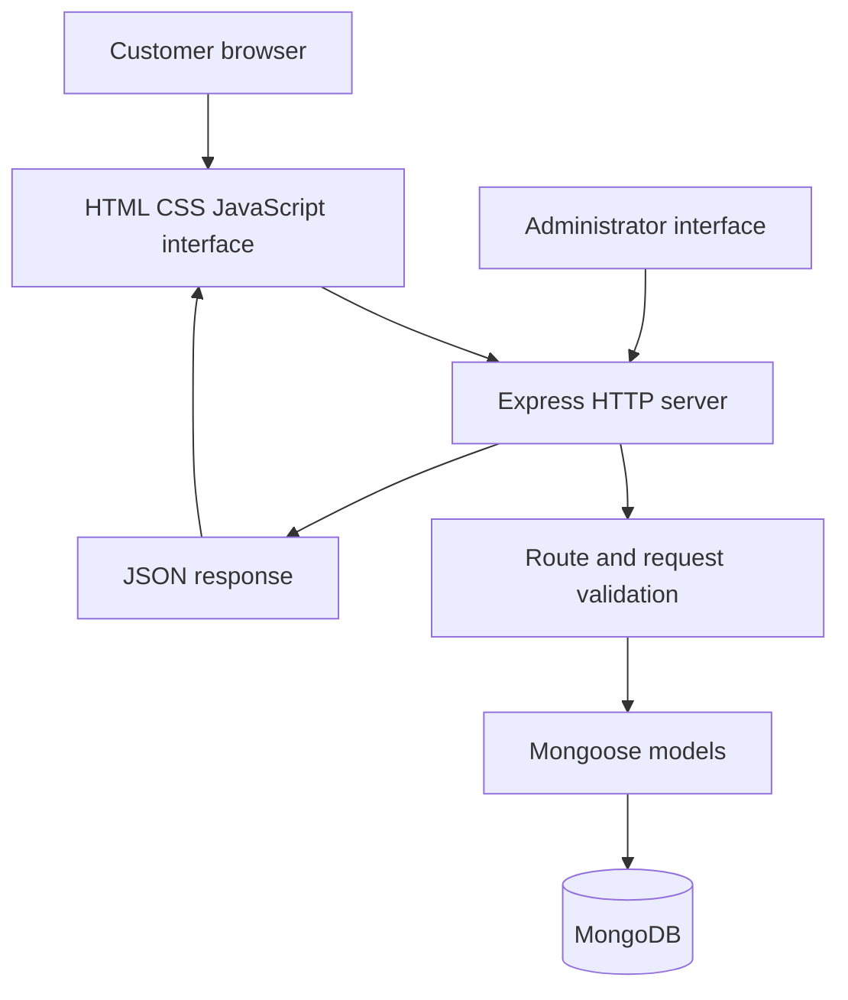

# Graphico — Architecture Overview

## Purpose

Graphico is an academic/personal printing-services application exploring customer enquiries, print-job submissions and administrative workflows.

## High-level flow

## Main responsibilities

- Frontend: catalogue, quote/enquiry forms and customer-facing interactions.
- Express: HTTP routes, middleware, file-upload handling and JSON responses.
- Mongoose: schema definitions and database operations.
- MongoDB: persistent quote, order and print-job records.
- Environment: database connection string and runtime configuration are provided outside source control.

## Important review findings

- The repository contains root-level and `backend/` server entry points. Confirm which application is intended before removing or merging either one.
- The backend server previously contained a database connection string in source. It has been changed to read `MONGODB_URI` from the environment. The credential must still be rotated because it appeared in Git history.
- Admin routes require proper authentication and authorization before any public deployment.
- File uploads need content-based validation, access control, safe storage and malware scanning before production use.
- Use synthetic data in public demonstrations.
