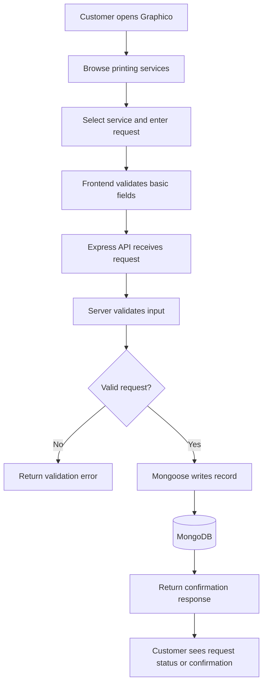

# Graphico — End-to-End Process Map

## Developer workflow

1. Read the existing route and model before editing.
2. Reproduce the issue with synthetic data.
3. Make a small change and validate inputs server-side.
4. Test success, invalid input, missing data and database failure paths.
5. Review the diff for credentials and personal data.
6. Update the README and commit with a clear message.

## Interview explanation

"Graphico is a printing-services web application prototype. I explored the customer request flow from the browser through Express routes and Mongoose models into MongoDB. I documented the system boundaries and identified security work required before deployment, including environment-based secrets, admin authorization and safe file handling."
